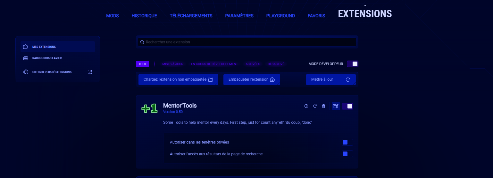
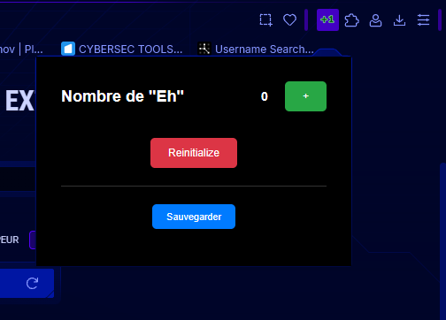
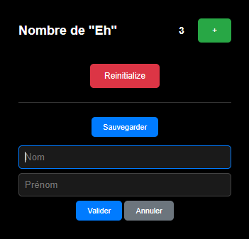
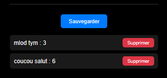

# Guide utilisateur : Mentor-Extension

Ce guide s'adresse à toute personne qui souhaite utiliser l'extension, **sans aucune connaissance en informatique**. Il suffit de suivre les étapes dans l'ordre.


## Sommaire

- [Guide utilisateur : Mentor-Extension](#guide-utilisateur--mentor-extension)
  - [Sommaire](#sommaire)
  - [1. À quoi sert l'extension ?](#1-à-quoi-sert-lextension-)
  - [2. Avant de commencer](#2-avant-de-commencer)
  - [3. Installer l'extension](#3-installer-lextension)
  - [4. Ouvrir l'extension](#4-ouvrir-lextension)
  - [5. Utiliser le compteur](#5-utiliser-le-compteur)
  - [6. Sauvegarder le score](#6-sauvegarder-le-score)
  - [7. Consulter et supprimer une sauvegarde](#7-consulter-et-supprimer-une-sauvegarde)
  - [8. Mettre à jour l'extension](#8-mettre-à-jour-lextension)
  - [9. Questions fréquentes](#9-questions-fréquentes)
  - [10. Petit lexique](#10-petit-lexique)

## 1. À quoi sert l'extension ?

Mentor-Extension est un **compteur de « Eh »** qui se trouve dans la barre d'outils de votre navigateur. À chaque « Eh », vous cliquez sur un bouton et le compteur augmente de 1. Vous pouvez ensuite **enregistrer le score** sous un nom et un prénom pour le retrouver plus tard.

## 2. Avant de commencer

Vous avez besoin de :

- **Google Chrome** (ou un navigateur similaire comme Microsoft Edge ou Brave) ;
- le **dossier de l'extension** (`Mentor-Extension`), que vous recevez de la personne qui vous la fournit.

## 3. Installer l'extension

L'extension n'est pas disponible sur le magasin d'extensions de Chrome. Elle s'installe donc à la main, en quelques étapes.

1. Si vous avez reçu un fichier `.zip`, **décompressez-le** (clic droit sur le fichier, puis « Extraire tout »).
2. Ouvrez Chrome, cliquez dans la barre d'adresse, tapez `chrome://extensions` puis appuyez sur **Entrée**.
3. En haut à droite de la page, activez l'interrupteur **Mode développeur**.
4. Cliquez sur le bouton **Charger l'extension non empaquetée**.
5. Choisissez le dossier `Mentor-Extension`, puis cliquez sur **Sélectionner le dossier**.



L'extension apparaît dans la liste. Elle est installée.

> **Astuce : garder l'icône visible.** Cliquez sur l'icône en forme de **puzzle** dans la barre d'outils de Chrome, puis sur l'**épingle** à côté de Mentor-Extension. L'icône restera toujours affichée.

## 4. Ouvrir l'extension

Cliquez sur l'icône de l'extension dans la barre d'outils. Une petite fenêtre noire s'ouvre : c'est le **popup**. Il contient le compteur et ses boutons.



Le popup se referme dès que vous cliquez ailleurs. C'est normal, vos données restent enregistrées.

## 5. Utiliser le compteur

| Pour... | Cliquez sur... |
|---|---|
| Ajouter 1 au compteur | Le bouton vert **+** |
| Remettre le compteur à 0 | Le bouton rouge **Reinitialize** |

Le compteur est conservé quand vous fermez le popup, et même quand vous fermez Chrome.

> **Important :** le bouton **Reinitialize** remet uniquement le compteur à 0. Il **ne supprime pas** vos sauvegardes.

## 6. Sauvegarder le score

Pour enregistrer le score actuel :

1. Cliquez sur le bouton bleu **Sauvegarder**. Un petit formulaire apparaît.
2. Tapez le **prénom** et le **nom**.
3. Cliquez sur **Valider**.



Le score apparaît alors dans la liste, sous le formulaire.

**À savoir :**

- Le prénom et le nom sont **obligatoires**. S'il en manque un, un message rouge vous l'indique.
- Pour fermer le formulaire sans rien enregistrer, cliquez sur **Annuler**.
- Si vous enregistrez une personne **déjà présente dans la liste** (même prénom et même nom, majuscules ou non), son ancien score est **remplacé** par le nouveau. Il n'y a pas de doublon.

## 7. Consulter et supprimer une sauvegarde

Les sauvegardes sont affichées sous le formulaire :

```
Prénom Nom : score
```

Pour en supprimer une, cliquez sur le bouton rouge **Supprimer** à côté d'elle.

> **Attention :** la suppression est **immédiate et définitive**. Il n'y a pas de confirmation et il n'est pas possible d'annuler.



## 8. Mettre à jour l'extension

Quand une nouvelle version vous est fournie :

1. Remplacez l'ancien dossier `Mentor-Extension` par le nouveau (en gardant le même emplacement).
2. Ouvrez `chrome://extensions`.
3. Cliquez sur le bouton **↻** (recharger) sur la carte de Mentor-Extension.

## 9. Questions fréquentes

**L'icône n'apparaît pas dans la barre d'outils.**
Cliquez sur l'icône en forme de puzzle et épinglez Mentor-Extension. Vérifiez aussi dans `chrome://extensions` que l'interrupteur de l'extension est bien activé.

**Je clique sur « + » mais rien ne se passe.**
Rechargez l'extension : dans `chrome://extensions`, cliquez sur ↻, puis rouvrez le popup.

**Le compteur augmente de 2 en 2.**
Cela vient d'une ancienne version de l'extension. Mettez-la à jour (voir la section 8).

**Des caractères bizarres s'affichent (par exemple « Prénom »).**
C'est un défaut d'une ancienne version. Mettez l'extension à jour (voir la section 8).

**Mon compteur ou mes sauvegardes ont disparu.**
Les données sont liées à votre profil Chrome. Elles disparaissent si vous désinstallez l'extension ou si vous changez de profil.

**Je ne peux plus ajouter de sauvegardes.**
Le nombre de sauvegardes est limité (quelques dizaines). Supprimez celles dont vous n'avez plus besoin.

**Deux personnes ont le même prénom et le même nom.**
L'extension les considère comme la même personne et remplace le score. Ajoutez par exemple une initiale au prénom pour les distinguer.

**Le message « Le nom et le prénom sont obligatoires » s'affiche.**
Remplissez les deux champs avant de cliquer sur **Valider**.

**Je n'ai pas trouvé de réponse à mon problème.**
Ouvrez une demande (une *issue*) sur la page GitHub du projet en indiquant ce que vous avez fait et ce que vous voyez à l'écran.

## 10. Petit lexique

| Mot | Signification |
|---|---|
| **Extension** | Petit programme ajouté à votre navigateur pour lui donner une fonction en plus |
| **Popup** | La petite fenêtre qui s'ouvre quand vous cliquez sur l'icône de l'extension |
| **Épingler** | Garder l'icône de l'extension toujours visible dans la barre d'outils |
| **Recharger** | Redémarrer l'extension pour qu'elle prenne en compte une mise à jour |
| **Sauvegarde** | Un score enregistré avec un prénom et un nom |