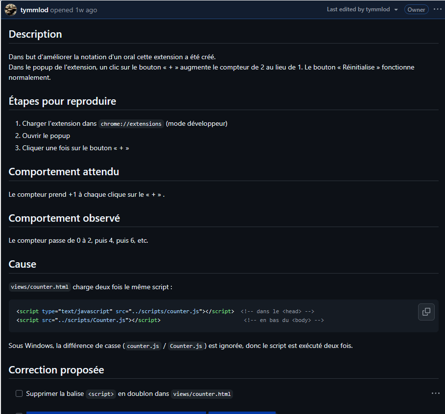
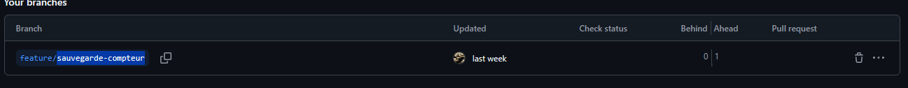
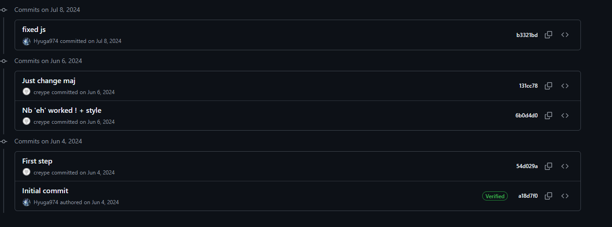

# Compte rendu — TP Bonus : Travail collaboratif & documentation technique

| | |
|---|---|
| **Projet** | Mentor-Extension |
| **Groupe** | THUILLIEZ Raphael, DIBON LANDRIEU Viktor, MLODZINSKI Tymoteusz |
| **Formateur** | Reype Costa |
| **Date** | 12 octobre 2026 |
| **Dépôt GitHub** | https://github.com/tymmlod/Mentor-Extension.git |

## 1. Présentation du projet

Mentor-Extension est une extension Google Chrome permettant de compter le nombre de fois où une personne prononce « Eh ». L’utilisateur peut augmenter ou réinitialiser le compteur, puis enregistrer la valeur associée à un prénom et un nom.

Les données du compteur et les sauvegardes restent disponibles après la fermeture du popup ou du navigateur. L’extension utilise l’API `chrome.storage.sync` pour conserver ces informations.

### Fonctionnalités réalisées

- Incrémentation du compteur à l’aide du bouton `+`
- Réinitialisation du compteur avec le bouton `Reinitialize`
- Persistance du compteur après fermeture du popup
- Création d’une sauvegarde avec prénom, nom et score
- Affichage des sauvegardes existantes
- Suppression d’une sauvegarde
- Remplacement du score lorsqu’une personne existe déjà dans la liste

> **Capture 1 — Aperçu de l’extension**
>
> 

---

## 2. Organisation collaborative GitHub

Nous avons suivi un workflow GitHub afin de garantir la traçabilité des modifications et d’éviter toute modification directe sur la branche `main`.

Le principe appliqué est le suivant :

1. Création d’une issue décrivant le besoin.
2. Création d’une branche dédiée depuis `main`.
3. Réalisation des modifications sur cette branche.
4. Création de commits avec des messages explicites.
5. Ouverture d’une Pull Request vers `main`.
6. Relecture par un membre du groupe.
7. Correction des remarques éventuelles.
8. Approbation, fusion de la Pull Request et fermeture de l’issue.

Ce fonctionnement isole les travaux et permet une revue du code avant l’intégration dans la branche principale. [4]

---

## 3. Issue GitHub

Une issue a été créée afin de transformer le besoin fonctionnel en tâche suivie dans GitHub.

| Élément | Contenu |
|---|---|
| **Numéro de l’issue** | 1 |
| **Titre** | Le compteur s'incrémente de 2 en 2 au lieu de 1 en 1|
| **Responsable(s)** | Mlodzinski Tymoteusz |
| **Statut final** | ouverte |
| **Lien** | https://github.com/tymmlod/Mentor-Extension/issues/1 |

### Description du besoin

L’issue décrit le besoin suivant :

> Dans but d'améliorer la notation d'un oral cette extension a été créé.
Dans le popup de l'extension, un clic sur le bouton « + » augmente le compteur de 2 au lieu de 1. Le bouton « Réinitialise » fonctionne normalement.

### Critères d’acceptation

- [ ] Supprimer la balise ``` <script> ``` en doublon dans views/counter.html
- [ ] Garder une seule référence, avec la casse exacte du fichier : ../scripts/counter.js

> **Capture 2 — Issue GitHub créée**
>
> 

---

## 4. Branche et commits

### Branche de travail

Aucune modification n’a été réalisée directement sur `main`. Une branche dédiée a été créée à partir de la branche principale.

| Élément | Valeur |
|---|---|
| **Branche de départ** | `main` |
| **Branche créée** | `feature/sauvegarde-compteur` |
| **Auteur de la branche** | Mlodzinski tymoteusz |
| **Objectif** | resoudre la première et deuxième issue |

Exemple de commande utilisée :

```bash
git checkout main
git pull origin main
git checkout -b feature/sauvegarde-compteur
```

> **Capture 3 — Branche de travail**
>
> 

### Commits réalisés

Les modifications ont été découpées en commits cohérents et nommés de façon descriptive.

> **Capture 4 — Historique des commits**
>
> 

---

## 5. Pull Request

Une Pull Request a été ouverte afin de proposer l’intégration de la branche de fonctionnalité dans `main`.


### Description de la Pull Request

La Pull Request précise :

- ce qui a été modifié ;
- pourquoi cette modification était nécessaire ;
- comment la fonctionnalité a été vérifiée ;
- le lien avec l’issue correspondante.


GitHub permet ainsi d’associer la discussion, les modifications, les commits et la validation à une même tâche.


---

## 6. Code review

La Pull Request a été relue par un autre membre du groupe. La revue a permis de vérifier le comportement de la fonctionnalité, la lisibilité du code et le respect des règles définies par les ADR.


### Exemple de retour de review

> **Commentaire :** « La comparaison des noms doit ignorer les majuscules et les espaces inutiles afin d’éviter les doublons. »

**Réponse apportée :** les champs sont nettoyés avec `trim()` puis comparés sans tenir compte de la casse. Lorsqu’une personne existe déjà, son score est remplacé tout en conservant son identifiant.

Après prise en compte des retours, la Pull Request a été approuvée puis fusionnée dans `main`. Une Pull Request centralise les échanges, les commentaires sur le code et l’état de validation avant fusion.

---

## 7. Fermeture de l’issue

Après l’approbation de la Pull